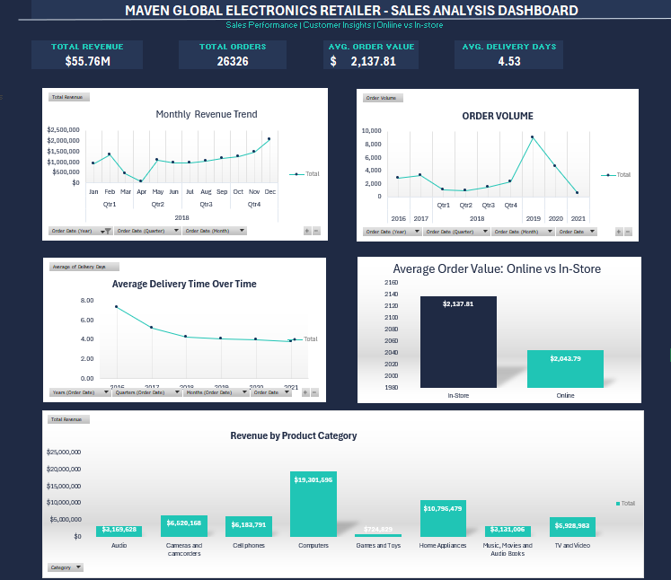

# Maven Global Electronics Retailer — Sales Performance Analysis

## Project Overview
This project analyses sales data for Maven Global Electronics Retailer using Microsoft Excel. The goal is to turn raw data into meaningful business insights through data analysis, calculations, and an interactive dashboard.

## Business Objectives
- Analyse overall revenue and order performance.
- Explore sales trends over time.
- Compare revenue across product categories.
- Investigate customer and product performance.
- Evaluate delivery efficiency and average delivery time.

## Business Questions

This project was guided by four key business questions:

1. How has revenue changed over time?
   Analyse revenue trends to identify periods of growth and decline.

2. Which products and product categories generate the most revenue?
   Compare product-category performance to understand where revenue is concentrated.

3. Who are the customers, and where are they located?
   Examine customer and geographic patterns to better understand the retailer's customer base.

4. How efficiently are orders being fulfilled?
   Analyse delivery times to evaluate fulfilment performance and identify opportunities for improvement.

## Tools Used
- Microsoft Excel
- PivotTables and PivotCharts
- Excel formulas and calculations
- Dashboard design and data visualisation

## Project Deliverables
- Excel workbook containing the source data and analysis.
- Sales performance dashboard.
- Visualisations of revenue, orders, product categories, and delivery performance.

## Key Skills Demonstrated
- Data cleaning and preparation
- Exploratory data analysis
- Business performance reporting
- Data visualisation
- Dashboard development
- Translating data into business insights

Key Findings

- Total Revenue: Approximately $55.76 million across the analysed sales data.
- Total Orders: 26,326 orders.
- Average Delivery Time: Approximately 4.53 days for orders with delivery dates.
- Sales Channels: In-store sales generated approximately $44.35 million, while online sales generated approximately $11.40 million.
- Order Value Comparison: Average order value was approximately $2,137.82 in-store and $2,043.79 online, based on the order counts used in the analysis.

Business Recommendations

- Evaluate online sales growth: Investigate opportunities to increase online revenue and improve the online shopping experience.
- Monitor delivery efficiency: Track delivery times over time to identify opportunities to improve fulfilment performance.
- Understand customer demand: Use customer-location and product-category analysis to identify opportunities for targeted marketing and inventory planning.
- Support data-driven decisions: Use the dashboard to monitor key sales metrics and identify areas requiring further investigation.

Limitations

The findings reflect the available dataset and the calculations performed in this project. Further analysis would be required to establish the causes of sales patterns and determine the impact of specific business interventions.

##Project Files

- "Excel Workbook" (./Global%20Electronics%20Retailers%20analysis.xlsx) — Download the Excel workbook containing the source data, analysis, calculations, and completed dashboard.
- "Dashboard Preview" (./dashboard-preview.png) — View the screenshot of the completed Excel dashboard.

## About This Project

This project was completed as part of my data analytics portfolio to demonstrate how Microsoft Excel can be used to transform raw retail data into meaningful business insights.

I analysed sales performance, revenue trends, product categories, customer data, and delivery efficiency. I then presented the results in a dashboard designed to make key performance indicators and trends easier to understand.

Through this project, I demonstrated practical skills in data preparation, analysis, calculations, data visualisation, dashboard development, and business reporting.

The project reflects my commitment to developing practical data analytics skills and using data to support informed business decisions.

## Author: Jane Mutileni
## Role: Data Analyst
## Tools: Microsoft Excel

